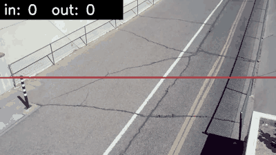
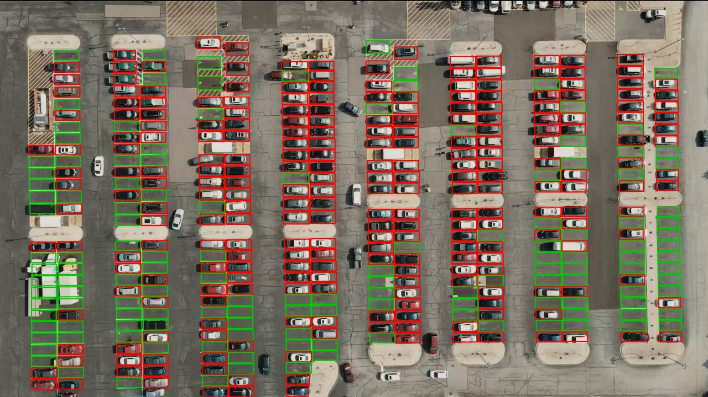

# yolo-video-analytics

Count objects crossing a line and measure zone occupancy in video, using detection + tracking. Runs as a CLI or a small API.

> Work in progress. Hand-count accuracy lands with milestone 5.



*`pedestrian.mp4` at 2x speed: yolo11n + tracker, final count in 5 / out 3. Made by `notebooks/kaggle_demo/make_gif.py`.*

## Results
| Clip | Model | Line | Tool count (in / out) | Hand count | Error |
| --- | --- | --- | --- | --- | --- |
| pedestrian.mp4 (30 s, 854x480, 735 frames) | yolo11n, ultralytics 8.4.191 | horizontal, middle of frame | 5 / 3 | _tbd_ | _tbd_ |

The tool count is from one real run on Kaggle (25 s for the whole clip, including model load). It has not been checked against a hand count yet.

Clip: `pedestrian.mp4` from the Kaggle dataset [jayitabhattacharyya/social-distance](https://www.kaggle.com/datasets/jayitabhattacharyya/social-distance), listed as Apache-2.0 (the uploader gives YouTube as the source). Not stored in this repo.

**Parking occupancy** (drone view, 396 spots from the dataset's mask, vehicles only; one Kaggle run, ultralytics 8.4.202)



| Clip | Model | Input size | Max detections | Mean share of frames occupied | Spots taken >50% of frames | Time (849 frames) |
| --- | --- | --- | --- | --- | --- | --- |
| parking_1920_1080.mp4 (28 s) | yolo11n (COCO) | 640 | 300 | 0.0 | 0 / 396 | 23.1 s |
| same | yolo11n (COCO) | 1920 | 300 | 0.0 | 0 / 396 | 19.4 s |
| same | yolo11n-obb (DOTA, aerial) | 1024 | 300 | 0.622 | 250 / 396 | 88.8 s |
| same | yolo11n-obb (DOTA, aerial) | 1920 | 300 | 0.599 | 239 / 396 | 98.1 s |
| same | yolo11n-obb (DOTA, aerial) | 1024 | 1000 | 0.643 | 256 / 396 | 87.1 s |

The COCO-trained model finds no vehicles in this top-down view, even at full resolution: COCO cars are photographed from the side, and from above a car is a small rectangle the model has not learned. The same-size model trained on aerial images (DOTA, rotated boxes) finds them.

ultralytics' default cap of 300 detections per frame was cutting off cars: with the cap raised to 1000, the first frame gives 336 detections instead of 300, and 258 spots taken instead of 254. The picture still shows a few taken spots marked free. Not yet checked against a hand count.

Clip: `parking_1920_1080.mp4` and `mask_1920_1080.png` from the Kaggle dataset [iasadpanwhar/parking-lot-detection-counter](https://www.kaggle.com/datasets/iasadpanwhar/parking-lot-detection-counter), listed as Apache-2.0. Not stored in this repo.

## Run it
```bash
pip install -e ".[dev]"        # core + tests, no YOLO
pip install -e ".[video]"      # adds ultralytics for real video
pytest
```

Count a video from the command line:
```bash
yva count clip.mp4 --line 0 240 854 240 --classes 0   # prints: in: <n>  out: <n>
```

Count a video from Python:
```python
from yva.pipeline import count_video

counter = count_video("clip.mp4", p1=(0, 240), p2=(854, 240), classes=[0])  # 0 = person
print(counter.count_in, counter.count_out)
```

Measure how often each parking spot is taken:
```python
from yva.pipeline import occupancy_video

zones = {"A1": [(100, 300), (200, 300), (200, 400), (100, 400)]}  # polygon corners in pixels
print(occupancy_video("parking.mp4", zones, classes=[2]))  # 2 = car -> {"A1": share of frames, 0 to 1}
```

Run on a Kaggle GPU (needs the [Kaggle CLI](https://github.com/Kaggle/kaggle-api), logged in):
```bash
kaggle kernels push -p notebooks/kaggle_count
kaggle kernels output assadkhurshid/yva-count-pedestrian -p out/
```

## How it works
1. **Detect + track**: YOLO with its built-in tracker gives each object a box and a track ID that stays the same across frames.
2. **Line crossing** (`yva.counting.LineCounter`): each track's box center is compared with its previous position. A crossing is counted when the two positions are on opposite sides of the line (sign of a 2D cross product) and the step passes between the line's end points. Works for any line angle and for fast objects that jump over the line between frames.
3. **Zone occupancy** (`yva.zones`): a zone is occupied when at least one object center is inside its polygon (ray casting). Two objects in one zone still count as one occupied zone. On video, `occupancy_video` reports each zone's share of frames occupied (0 to 1). It uses plain detection, no tracker: "is the spot taken?" doesn't need to know which car it is.

## Limitations
- Each track is counted at most once per direction. A person who crosses in, out and in again counts as in 1, out 1.
- A track that loses its ID (occlusion) and comes back with a new ID can be counted twice.
- The box center is used as the object's position. For people seen from above or at an angle, the feet (box bottom) can be a better point.
- A center exactly on a zone's edge can land either way.
- Counts above are not yet validated against a hand count.
- The default COCO model does not work on top-down (drone) footage: it detected 0 cars in the parking clip. Use an aerial model such as yolo11n-obb there.
- `occupancy_video` keeps ultralytics' default cap of 300 detections per frame; pass a higher `max_det` for a large lot. `count_video` has no such option yet.
